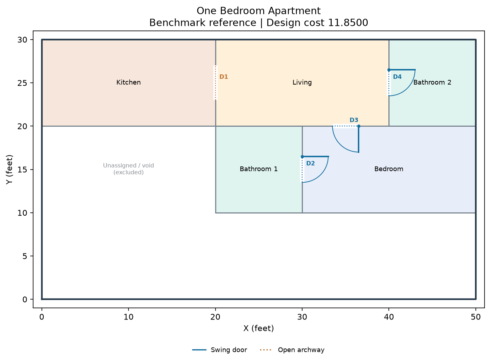

# DoorLab

DoorLab helps designers explore interior door layouts inside Autodesk Revit. Starting from modeled walls and rooms, it generates candidate door positions, checks opening clearances, and compares validated plans with a design-cost breakdown. Select a plan to place its doors and passage openings in the model, including hinge side and swing direction.

[Download v0.1.1 and examples](https://github.com/yingzixu233/DoorLab/releases/tag/v0.1.1) · [Quick start](QUICKSTART.md)

This benchmark image is generated from the original Notebook sample JSON.

The v0.1.1 pre-release includes the following Windows x64 builds. Both builds and the combined installer checks have passed. The author has confirmed successful manual workflow testing in Revit 2027.4. See the release notes for the verification scope.

| Revit | DoorLab runtime | API file version used for the build |
|---|---|---|
| Revit 2026, .NET 8 releases | .NET 8 | 26.0.10.8 |
| Revit 2027 | .NET 10 | 27.4.0.31 |

Revit 2026.5 and later updates use .NET 10 and need a separate Revit 2026 build. That build, Revit 2024 and Revit 2025 builds are outside this release. The installer matches both the Revit year and its runtime to an available build. [Autodesk runtime compatibility guidance](https://www.autodesk.com/support/technical/article/caas/sfdcarticles/sfdcarticles/Compatibility-and-performance-considerations-when-running-different-versions-of-Revit-together.html)

## Install and run

Close all Revit windows, download `DoorLabSetup.exe`, and double-click it. The setup window detects Revit installations and shows which have a matching DoorLab build. Select the versions to install, click **Install**, then **Finish**. Reopen Revit and find **DoorLab - Export Floorplan** and **DoorLab - Plan Door Layout** under **Add-Ins → External Tools**. The installer includes the solver and its Python dependencies. This pre-release installer is unsigned, so Windows may display a publisher confirmation.

The installation-location fix in v0.1.1 reads Autodesk product registrations and Windows uninstall records, covering custom installation drives as well as the standard installation folder. A detected Revit version with no matching DoorLab build is reported separately from a Revit installation that cannot be found.

The settings window has four pages. **Openings & Clearances** selects family types, widths and clearances. **Layout Rules** controls the circulation start and bathroom fallback. **Scoring** edits circulation preferences and room-connection costs. **Search Settings** controls position sampling and the search budget. Question-mark buttons provide field explanations. Length inputs accept feet, inches, feet-and-inches, millimeters, centimeters and meters. The selected family type supplies the actual width used by the solver.

Click **Generate Plans** to solve in the background and open **Compare Door Plans**. Lower design cost is better. **Score Breakdown** shows each cost contribution. The search considers a finite set of sampled positions, opening directions and hinge sides. A complete search enumerates all equal-best plans in that candidate set. An incomplete search shows the validated equal-best plans found within the search budget.

## Model scope

This version works with one floor-plan scope, an unrotated rectangular exterior, straight basic walls, and one closed boundary loop per room. Supported room names include `Living`, `Kitchen`, `Bedroom 1` and `Bathroom 1`, with corresponding Chinese names. Unassigned regions are excluded from the circulation model. Clearance checks use room boundaries, opening approach strips and door sweeps. Furniture and other equipment require additional designer review.

## Examples

Choose the separate example download that matches your Revit version:

| Download | Model format |
|---|---|
| `DoorLab_Examples_Revit2026.zip` | Revit 2026 |
| `DoorLab_Examples_Revit2027.zip` | Revit 2027 |

Each package contains Floorplan 1, Floorplan 3 and Floorplan 6, with a separate folder for each model, such as `Floorplan_1/Floorplan_1_blank.rvt`. Start with `EXAMPLES_GUIDE.md` in the archive, or read the [examples guide](docs/EXAMPLES_GUIDE.md) online. Preserve the supplied model and test a doorless working copy.

Revit 2026 cannot open the 2027 models. If upgrading a 2026 model in Revit 2027, copy its entire example folder first and save only the upgraded copy.

The accompanying reference PNGs are benchmark layouts generated from the original Notebook sample JSON. [ReferenceSettings.json](docs/ReferenceSettings.json) records their settings. Revit export coordinates, geometry details, actual family widths and equal-cost alternatives can affect the resulting layout and score. Use the Revit-generated preview to verify the doors applied to your model.

For feedback, include the full Revit build number, selected family types and widths, relevant settings, and steps to reproduce the issue.
